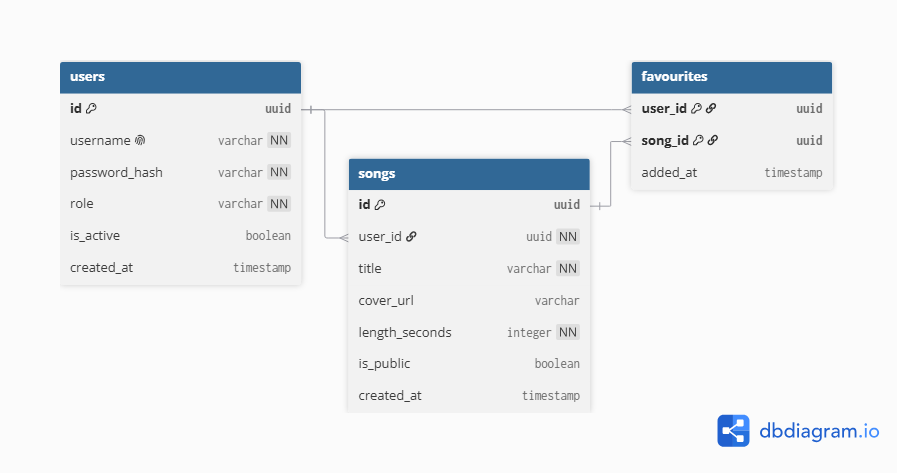

# Resonance — Audio Streaming Backend API 🚧 (Active Development)

RESTful backend architecture built with **Python** and **FastAPI**, following a strict **Service Layer pattern**.

## Tech Stack & Architecture
- **Framework:** FastAPI + Pydantic v2 (DTO validation)
- **Database & ORM:** PostgreSQL / SQLite + SQLAlchemy + Alembic migrations
- **Security:** OAuth2 JWT authentication, Bcrypt password hashing, custom RBAC dependencies (`Listener`, `Musician`, `Admin`)
- **Audio Processing:** `mutagen` for automated metadata extraction
- **Quality & Testing:** Integration test suite (`pytest` + `TestClient`) and `ruff` linter/formatter
- **Infrastructure:** Docker & Docker Compose
- 
## 🗄️ Database Architecture

